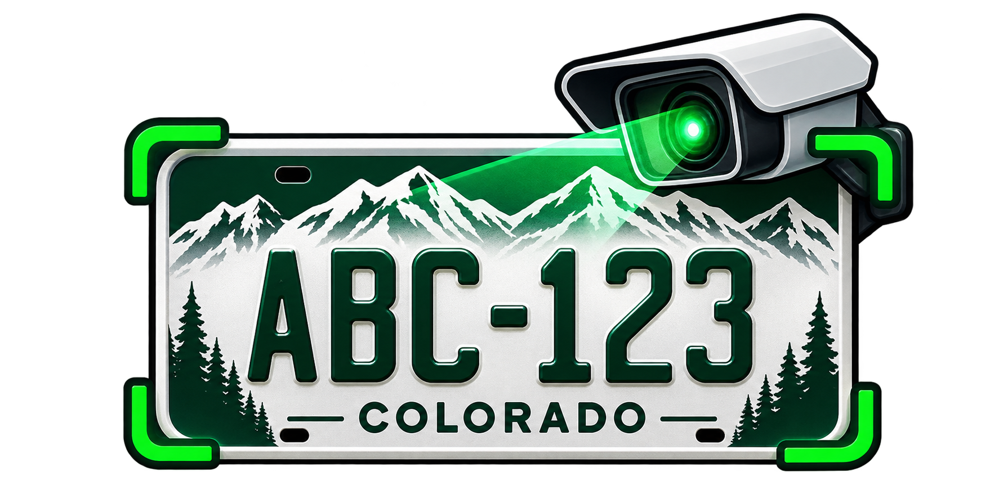

<p align="center"></p>

# Colorado ANPR

Video-based license plate recognition with **YOLOv9**, **CCT OCR**, plate tracking, and multi-frame weighted consensus. Includes optional overlapping tiling, focused rescans and adaptive frame sampling for small or fast-moving plates. Runs as a standalone Python project; model weights are downloaded at first use.

## Run

Requires Python 3.10+ and FFmpeg (recommended for H.264 export).

```bash
python -m venv .venv
## macOS/Linux: source .venv/bin/activate
## Windows PowerShell: .\.venv\Scripts\Activate.ps1
pip install -r requirements.txt
```

Place your original video at `data/input/video.mp4` (or change `VIDEO_PATH` in `config.py`), then run:

```bash
python main.py inspect
python main.py run
```

Edit `config.py` to process `vvideo.mp4`, limit `MAX_SECONDS`, enable `TILING = "grid"` for small plates, or set `REGION_FORMAT = "AZ"` for standard Azerbaijani plate formatting. Default inference uses CPU ONNX, as in the notebook.

## Outputs

Saved in `data/output/`:

- `annotated_video.mp4` — bounding boxes and accepted/uncertain labels (or `annotated_raw.mp4` if FFmpeg is missing).
- `recognized_plates.csv` — one final weighted-vote decision per plate track.
- `plate_observations.csv` — all sampled OCR predictions, confidence and image quality.
- `best_plate_crops/` — highest-quality original-pixel crop per track.

Optional commands:

```bash
python main.py snapshot --second 2
python main.py labels
# Fill the true_plate column in data/output/ground_truth.csv manually.
python main.py evaluate
python -m unittest discover -s tests -v
```

## Notes

The plate detector/OCR models are pretrained; this project does **not** train or fine-tune them. Tiling helps detection but cannot recreate unreadable pixels. Repeated OCR guesses can still be wrong, and greedy plate-level tracking may confuse nearby vehicles. This is a research/prototyping pipeline, not a verified production identification system. Measure accuracy on labeled videos before relying on results. Handle recordings and plate numbers in accordance with applicable privacy rules.
