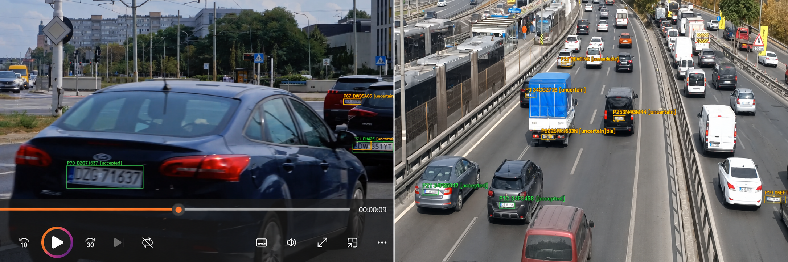

# ANPR

Video-based license plate recognition with **YOLOv9**, **CCT OCR**, plate tracking, and multi-frame weighted consensus. Includes optional overlapping tiling, focused rescans and adaptive frame sampling for small or fast-moving plates. Runs as a standalone Python project; model weights are downloaded at first use.

## Demo
